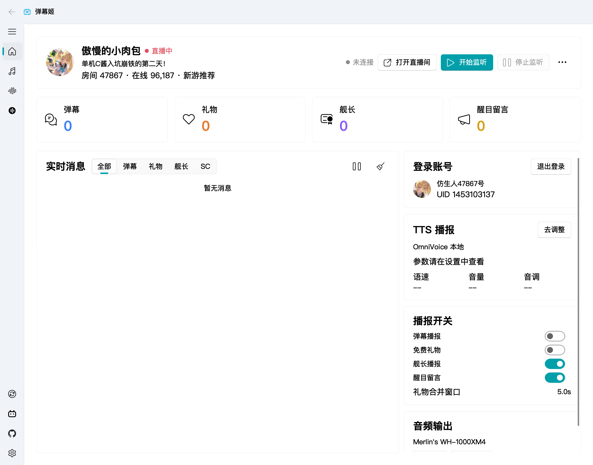
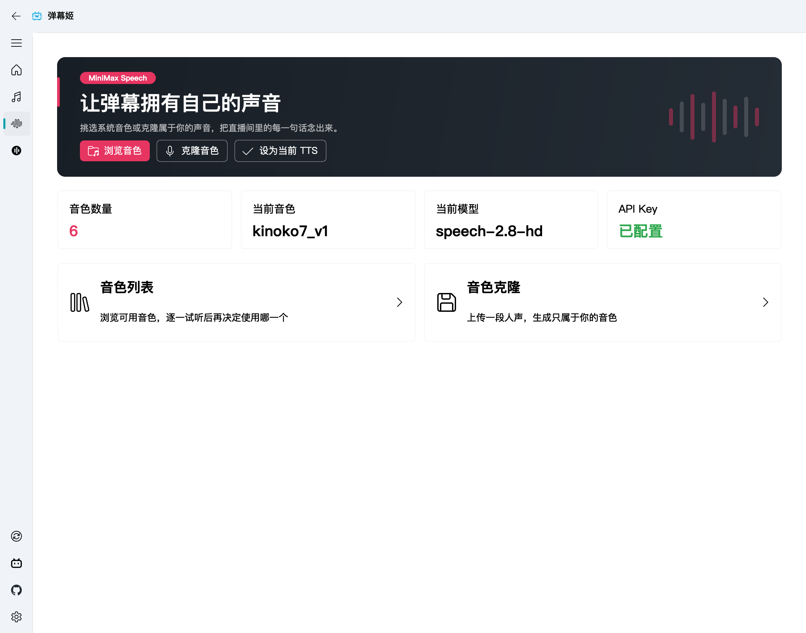
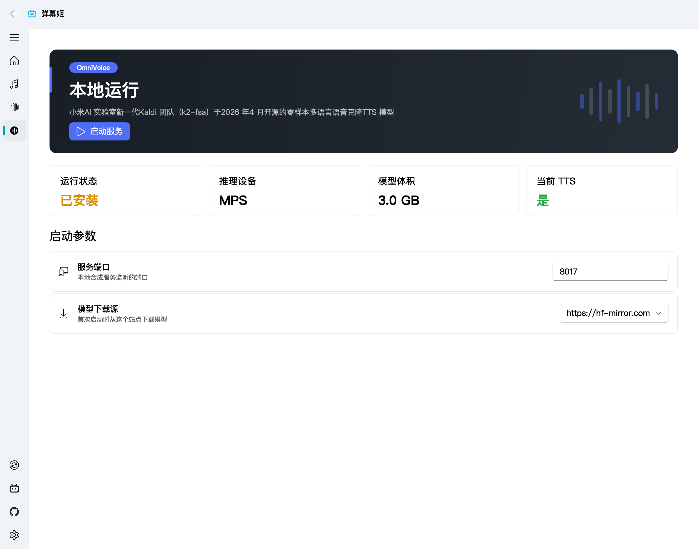
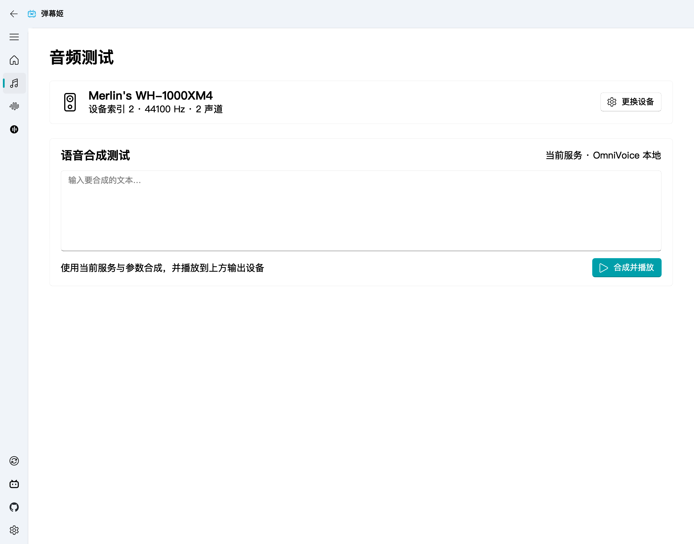
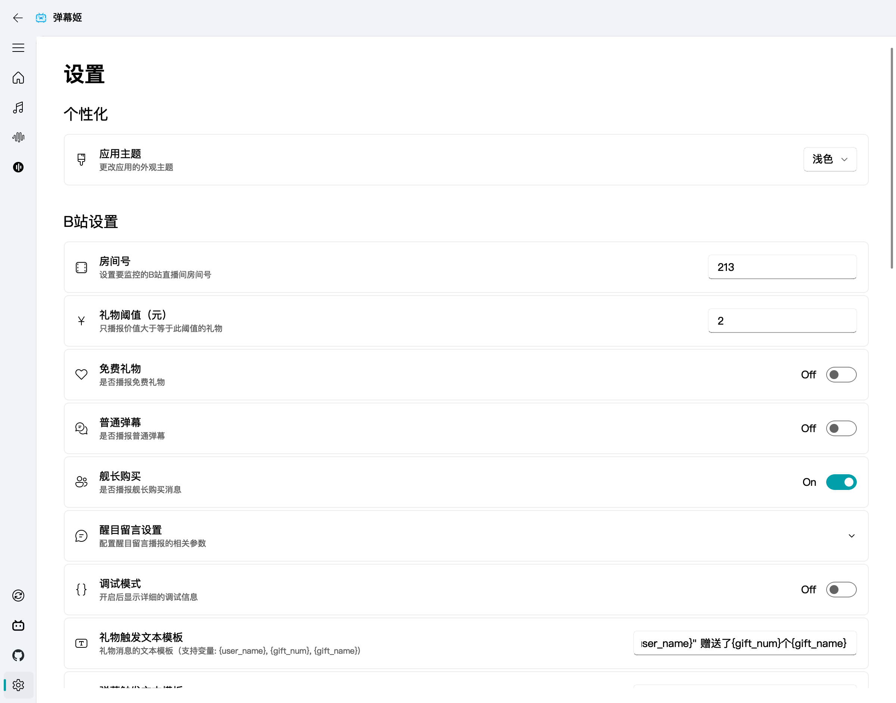
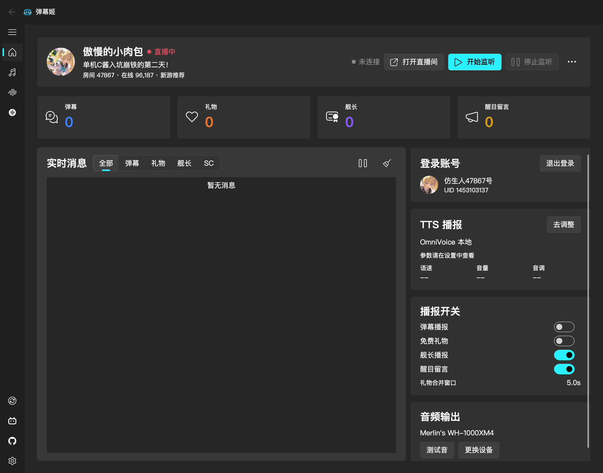

<div align="center">


[](LICENSE)
[](https://www.python.org/)
[](https://github.com/MerlinCN/kinoko7danmaku/actions/workflows/pyinstaller.yml)
[](https://github.com/MerlinCN/kinoko7danmaku/releases)

</div>

基于 PySide6 的 B 站直播弹幕姬，实时将弹幕、礼物、SC、舰长等消息转为语音播报。

## 特性

- **多 TTS 引擎** — 支持 MiniMax、OmniVoice 本地、Edge 三种语音服务
- **实时监控** — 弹幕 / 礼物 / SC / 舰长 / 醒目留言实时捕获与播报
- **礼物合并** — 短时间内的连续礼物自动合并播报，避免刷屏
- **别名字典** — 支持特殊词汇的自定义发音替换
- **文本模板** — 各类消息的播报文案可自由定制
- **本地语音克隆** — OmniVoice 在本机推理，参考音频不出本机
- **音频测试** — 输入文本用当前 TTS 服务合成播放，可随时切换输出设备
- **扫码登录** — 通过 B 站 APP 扫码安全登录
- **主题与更新** — 浅色 / 深色主题，启动时检查新版本并支持应用内更新
- **跨平台** — 提供 Windows 可执行文件，macOS / Linux 可从源码运行

## 截图

直播控制台：房间信息、本次连接统计、实时消息流与播报开关



MiniMax 语音合成：音色列表、音色克隆与试听



OmniVoice 本地推理：一键安装运行时、启动服务，用一段参考音频完成克隆



音频测试：选好输出设备，输入文本直接合成试听



设置：B 站服务、各 TTS 服务参数、输出设备与诊断



支持浅色与深色主题：



## 快速开始

### 环境要求

- Python 3.12+
- [uv](https://docs.astral.sh/uv/)（推荐包管理器）

### 安装 & 运行

```bash
git clone https://github.com/MerlinCN/kinoko7danmaku.git
cd kinoko7danmaku
uv sync
uv run src/main.py
```

启动后：
1. 首次启动用 B 站 APP 扫码登录，之后会自动恢复登录态
2. 在设置页面配置 TTS 服务与直播间房间号
3. 回到主页点击「开始监听」

### Windows 用户

直接下载 [Releases](https://github.com/MerlinCN/kinoko7danmaku/releases) 中的 `Kinoko7Danmaku.exe`，无需安装 Python。

## 支持的 TTS 服务

| 服务 | 说明 | 需要 API Key |
|------|------|:---:|
| MiniMax | 高品质云端语音合成 | ✅ |
| OmniVoice 本地 | 零样本语音克隆，本机推理 | ❌ |
| Edge | 微软免费 TTS | ❌ |

OmniVoice 需要 Apple Silicon 或 NVIDIA 显卡（不支持 CPU 推理）。首次使用在 OmniVoice 页点「安装本地运行时」，之后点「启动服务」即可，PyTorch 与模型会自动下载到 `~/.kinoko7danmaku/runtimes/` 和系统 HuggingFace 缓存。

## 设置

所有配置在 GUI 设置页面中完成，包括：

- **B 站服务** — 直播间房间号、弹幕开关、礼物阈值
- **TTS 服务** — 选择引擎及对应参数（语速、音色等）
- **音频输出** — 输出设备选择
- **别名字典** — 自定义词汇发音替换
- **文本模板** — 各类消息的播报文案
- **诊断** — 匿名错误上报开关（只发报错与日志，不含密钥、弹幕与登录信息）

配置自动保存至 `~/.kinoko7danmaku/config.json`，其中的 API Key 用本机密钥加密后存储。

## 支持与贡献

觉得好用可以给项目点个 Star，或者去 [爱发电](https://afdian.net/a/MerlinCN) 投喂我。

有意见或建议欢迎提交 Issues 和 Pull Requests。

感谢以下贡献者：

<table>
  <tr>
    <td align="center">
      <a href="https://github.com/zjp-shadow">
        <br />
        <sub><b>shadow</b></sub>
      </a>
    </td>
  </tr>
</table>

## 许可证

[GNU AGPL v3](LICENSE) © MerlinCN
